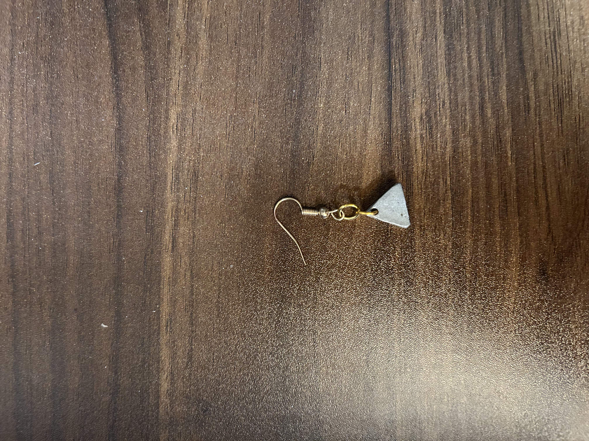

# Silver–Copper Alloy Earrings

Used color data fitted to <a href="https://en.wikipedia.org/wiki/CIELAB_color_space" target="_blank">CIELAB</a> to predict the apparent color of silver–copper alloys across a range of weight percents, picked composition with lowest wt% Ag (56%) that still appeared mostly silver.

## Fab

Metal clay is fine metal powder held together by cellulose. I mixed silver and copper clays, pressed them into a silicone mold, annealed the pieces to dry and set the clay, and finally sintered them with a torch and polished them with a brass brush. 

[← Back to projects](../)
