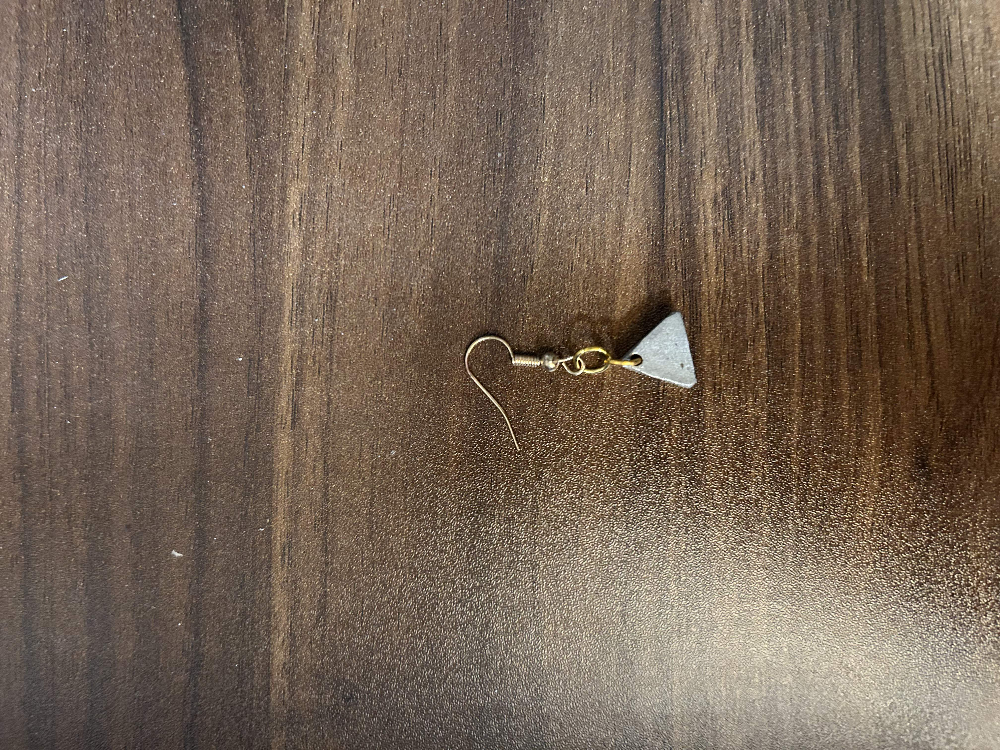

# Silver–Copper Alloy Earrings

A pair of earrings where the color was designed before the metal was mixed. I used CIELAB color data to model the apparent color of silver–copper alloys across a range of weight percents, picked a composition that looks like white gold at a fraction of the cost, and made it from silver and copper metal clays.

## Modeling the color

CIELAB describes color with three coordinates: L\* (lightness), a\* (green to red), and b\* (blue to yellow). It's built to be roughly perceptually uniform, so distances in Lab space track how different two colors actually look, which makes it a good space for predicting how a mix of two metals will appear. Using CIELAB data, I modeled how the apparent color shifts from silver's cool white toward copper's warm pink-orange as the copper content increases.

I chose 56 wt% Ag, where the model predicted a color very close to white gold (for a fraction of the cost).

## Fabrication

Metal clay is fine metal powder held together by an organic binder, so it can be shaped like clay. I combined silver and copper clays in the 56/44 ratio and pressed them into a silicone mold. I then annealed the pieces to dry and set the clay, and finally sintered them. During sintering the binder burns off and the metal particles fuse into solid metal, yielding the final alloy and its color.

[← Back to projects](../)
