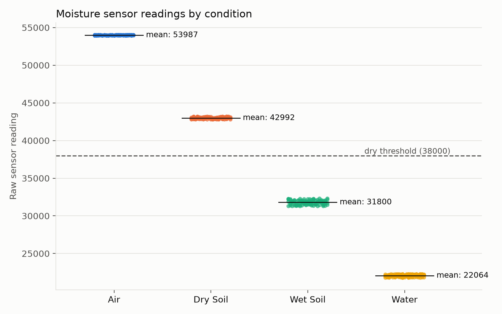
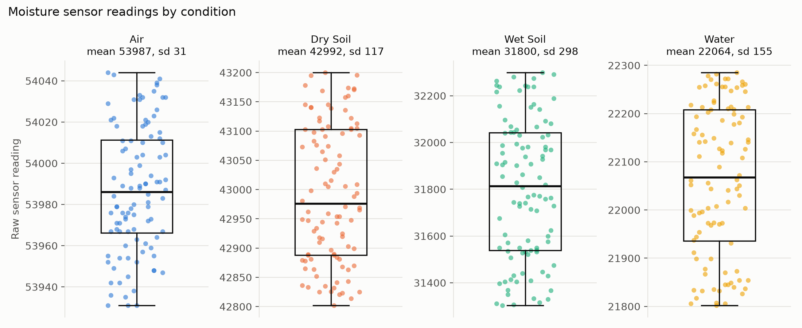

# The Soil Sentinel ™

Keeps an eye on a plant's soil and, when it's dry, gets the attention of whoever walks by. Built with a Raspberry Pi Pico 2 running CircuitPython.

## Demo

<figure>
<figcaption>Soil is dry:</figcaption>
<video src="IMG_7015.mp4" controls width="40%"></video>
</figure>

<figure>
<figcaption>After watering:</figcaption>
<video src="IMG_7011.mp4" controls width="40%"></video>
</figure>

## Sensor calibration

<figure>
  <figcaption>Raw data from moisture sensor in different states</figcaption>
  
  
</figure>

## Hardware

- Raspberry Pi Pico 2 running CircuitPython
- Capacitive soil moisture sensor (selected over resistive sensor to mitigate corrosion)
- HC-SR04 ultrasonic distance sensor for motion detection
- 9 g micro servo driving a rocking platform for the watering can

<!-- Video goes here -->

<!-- Photos go here -->

[← Back to projects](../)
