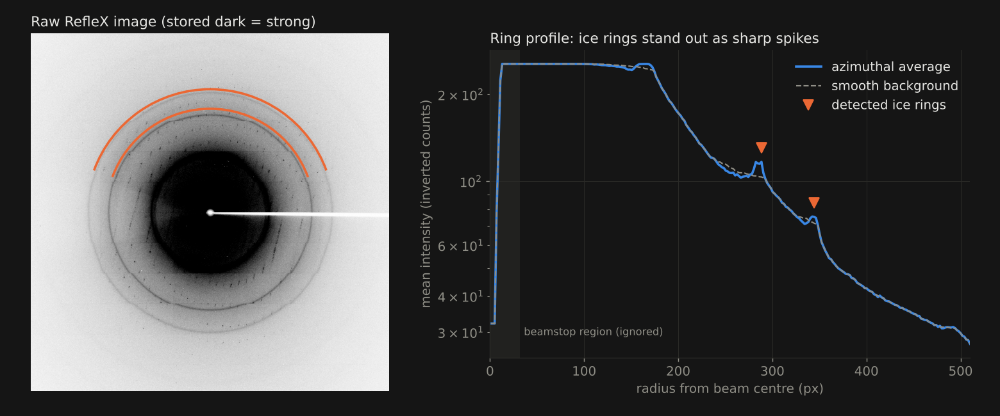
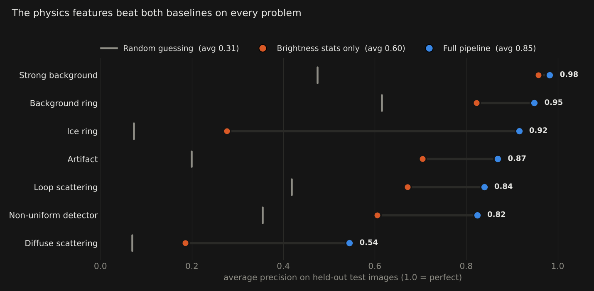
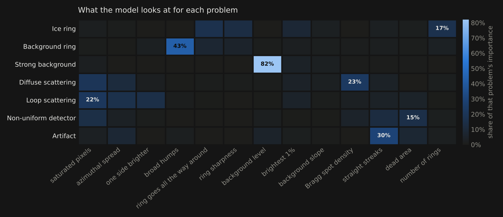

# Flagging Bad X-ray Diffraction Images

Pipeline that flags raw X-ray diffraction images for seven kinds of problems: ice rings, background rings, strong background, diffuse scattering, loop scattering, non-uniform detector response, and artifacts. 

## Workflow
Instead of training a black-box neural network on the pixels, it reduces each image the way a person might read it, so the model can show the reason for flagging an image.

1. **Mask the detector.** Ignore the beamstop, its shadow, and gaps between detector modules.
2. **Find the beam center.** The images come with no geometry information, so I pick the center that makes the pattern most symmetric around it.
3. **Average intensity in rings.** I bin intensity by distance from the center (256 bins), split into 16 angular sectors. Taking the median across sectors keeps single Bragg spots from looking like rings.
4. **Extract features.** 29 numbers per image, each aimed at a problem class: how sharp the strongest ring is and whether it goes all the way around, background level and slope, broad diffuse humps, whether one side of the detector is brighter than the other, Bragg spot density, and saturation, dead areas, and straight streaks.
5. **Classify.** One gradient-boosted classifier per problem class (scikit-learn), with decision thresholds tuned on a validation set.

## Results

On the dataset's held-out test set:

| Problem | ROC-AUC | F1 |
|---|---|---|
| Strong background | 0.983 | 0.92 |
| Ice ring | 0.982 | 0.87 |
| Artifact | 0.948 | 0.77 |
| Background ring | 0.918 | 0.88 |
| Diffuse scattering | 0.906 | 0.53 |
| Non-uniform detector | 0.889 | 0.76 |
| Loop scattering | 0.878 | 0.77 |
| **Average** | **0.929** | **0.78** |

ROC-AUC measures how well (0-1) the model ranks images with a problem above images without it. F1 measures how accurate the yes/no choices are.

To find what the model relies on, I shuffled one feature at a time on the validation set and measured how much the score dropped ([permutation importance](https://scikit-learn.org/stable/modules/permutation_importance.html)). For four of the problems, the reasoning lines up with the physics:

- **Ice rings** are flagged mainly by the number of rings, whether the sharpest one goes all the way around, and how sharp it is.
- **Background rings** are flagged by broad humps in the ring profile.
- **Strong background** comes almost entirely from the background level.
- **Artifacts** are flagged by the straight-streak detector.

The other three are less convincing. Loop scattering leans on saturated pixels, though one-sided brightness helps too. Non-uniform detector response leans on dead area and saturated pixels, and diffuse scattering on Bragg spot density and saturated pixels. These are correlations rather than physical signatures of those problems. Diffuse scattering also has only 44 examples in the test set, so its yes/no calls are unreliable despite the decent ranking. Future versions will use features that describe the shape of those signals directly.

## Code

Written in Python with NumPy, SciPy, scikit-image, and scikit-learn. The code is in this folder: [`xrdpipe/`](xrdpipe/) has the pipeline; see [`README.md`](README.md) for instructions.

*Dataset: A. Czyzewski, F. Krawiec, D. Brzezinski, P. J. Porebski, "RefleX: X-ray diffraction images dataset," Zenodo (2019), [10.5281/zenodo.2605120](https://doi.org/10.5281/zenodo.2605120), CC BY 4.0.*

[← Back to projects](../)
