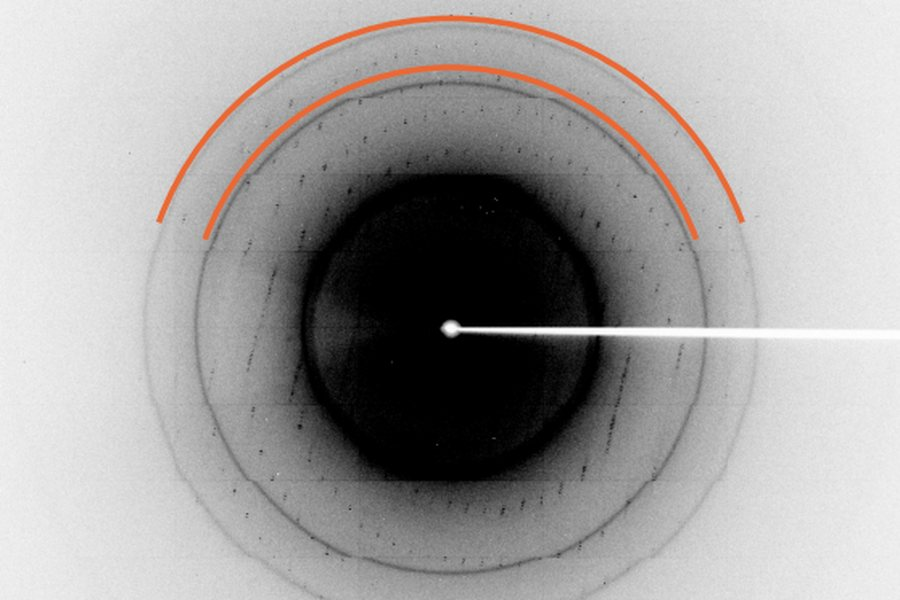
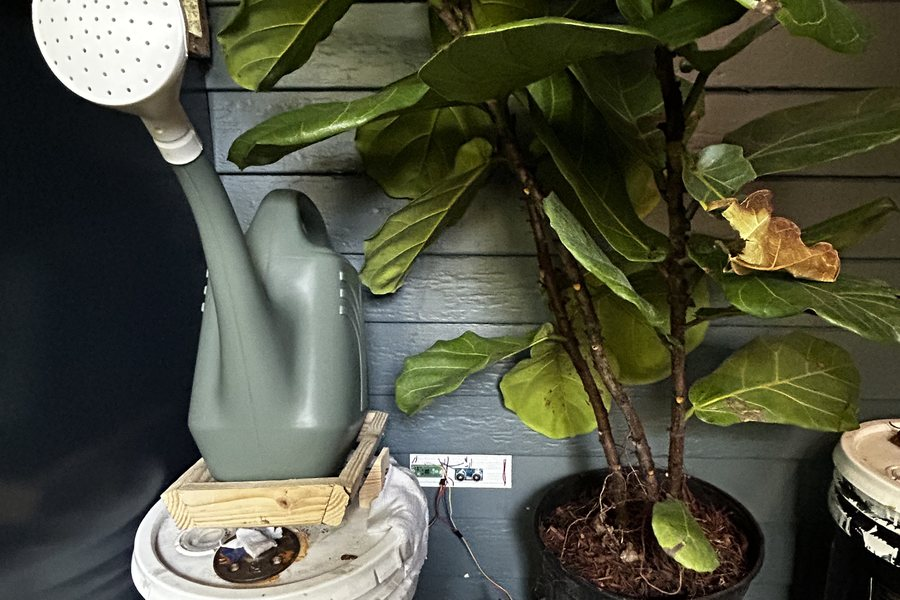
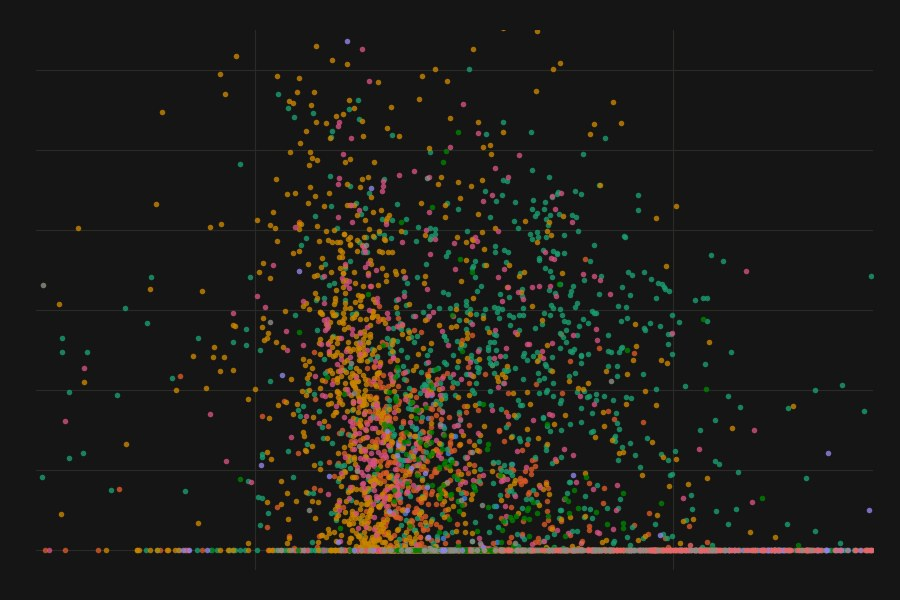
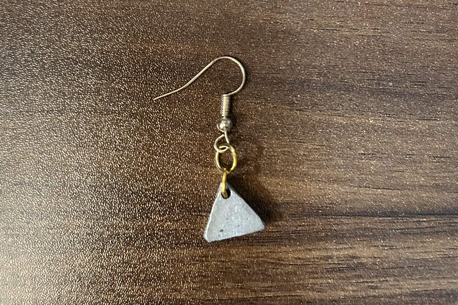

  
  

    <h2>X-Ray Diffraction Image Analysis Pipeline</h2>
    
Machine learning model that flags XRD images for various anomalies

    
<a href="XRD-Image-Anomaly-Detection/">Check it out →</a>

  

  
  

    <h2>The Soil Sentinel ™</h2>
    
Monitors plant moisture and prompts passerby to water the plant if it's dry

    
<a href="Soil%20Sentinel/">Check it out →</a>

  

  
  

    <h2>2D Materials Interactive Ashby Plot</h2>
    
Interactive Ashby-style property maps of 6,000+ 2D materials from 2DMatPedia

    
<a href="2D-Materials-Interactive-Ashby-Plot/">Check it out →</a>

  

  
  

    <h2>Silver–Copper Alloy Earrings</h2>
    
Earrings made from sintered Ag / Cu metal clay

    
<a href="Silver-Copper-Alloy-Earrings/">Check it out →</a>

  

## Modular Guitar Pedal

Coming soon
